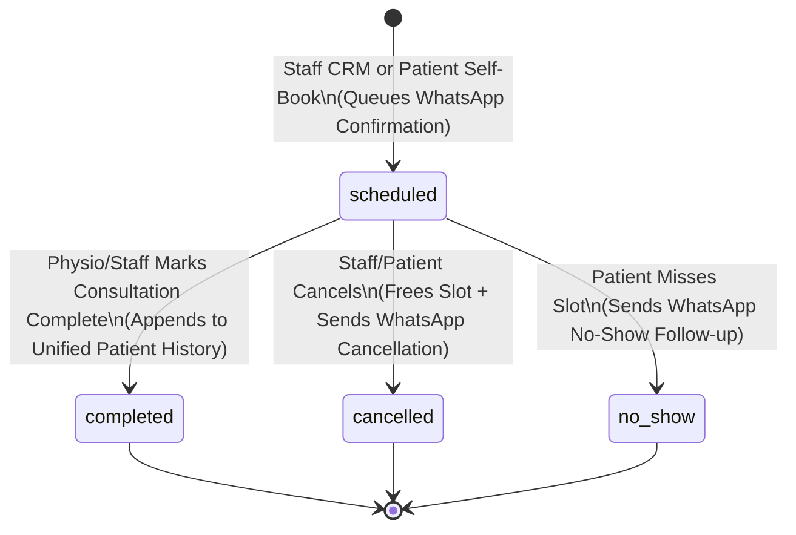
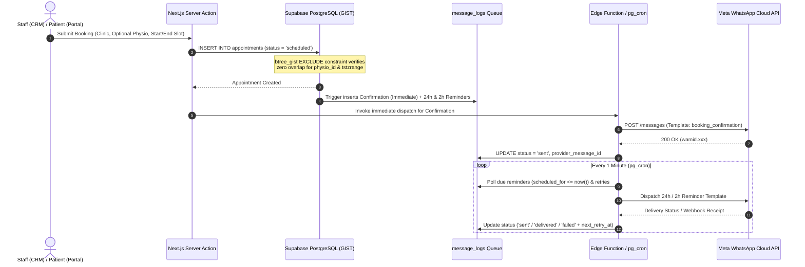
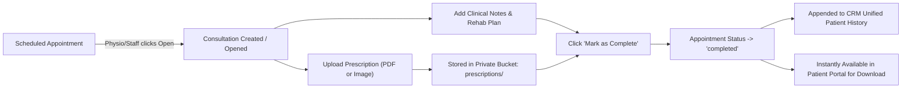

# Product Requirements Document (PRD): The Physio Lab CRM & Patient Portal

**Document Status:** Phase 1 Architecture Review  
**System Name:** The Physio Lab — Multi-Clinic Physiotherapy & Rehabilitation Management System  
**Architecture Paradigm:** Cloud-Native, Mobile-First Web Application (Next.js App Router + Supabase + Meta WhatsApp Cloud API)

---

## 1. Executive Summary & Project Objectives

**The Physio Lab** requires a centralized, cloud-based Physiotherapy & Rehabilitation Centre Management System that replaces fragmented manual record-keeping (physical registers, spreadsheets, and disconnected messaging apps) with a unified, real-time digital platform.

### 1.1 Core Problems Solved
- **Eliminate Manual Registers & Excel Sheets:** Standardize clinical, operational, and patient records in a single relational database with audit readiness and traceability.
- **Prevent Scheduling Conflicts & No-Shows:** Enforce strict database-level double-booking prevention with flexible manual slot durations, paired with automated WhatsApp lifecycle notifications.
- **Unify Patient Clinical History:** Aggregate all appointments, clinical notes, and PDF/image prescriptions under a single longitudinal patient profile accessible across branches.
- **Elevate Patient Experience (Primary Selling Point):** Deliver a high-converting public clinic showcase website that transitions seamlessly into a WhatsApp OTP-authenticated Patient Portal for self-service booking, appointment tracking, and prescription downloads.

### 1.2 System Pre-Requisites
- **Browser-Based Cloud Application:** Zero local installation required; accessible via any modern web browser.
- **OS & Device Independent:** Responsive, mobile-first layout optimized for desktop reception desks, physio tablets/phones on the clinic floor, and patient smartphones.
- **Strict Role-Based Access Control (RBAC):** Enforced at both the Next.js middleware/application layer and PostgreSQL Row Level Security (RLS) layer.
- **Real-Time Operational Dashboards:** Live schedule synchronization, consultation status tracking, and decision-making analytics.

---

## 2. Target Modern Tech Stack & Data Layer Abstraction

### 2.1 Technology Stack
| Layer | Technology | Purpose |
| :--- | :--- | :--- |
| **Frontend Framework** | Next.js 15+ (App Router), React 19, TypeScript | Server-rendered showcase pages, RSC data fetching, Server Actions, and client-side interactive CRM views. |
| **Styling & UI Components** | Tailwind CSS + `shadcn/ui` + Lucide Icons | Accessible, mobile-friendly component system with consistent clinical design tokens. |
| **Calendar & Scheduling UI** | FullCalendar (DayGrid / TimeGrid / List) or Custom Virtualized Grid | Multi-clinic, multi-physio daily/weekly calendar and agenda list views with drag/resize support for manual slot durations. |
| **Database & Backend** | Supabase (PostgreSQL 16+) | Relational storage, `btree_gist` exclusion constraints for zero double-booking, triggers, and views. |
| **Authentication** | Supabase Auth + Custom WhatsApp OTP Flow | Email/Password or Magic Link for CRM staff/physios/admins; custom WhatsApp OTP verification bridged to Supabase Auth JWT sessions for Patients. |
| **File Storage** | Supabase Storage (Private Bucket) | Secure storage for consultation prescriptions (`application/pdf`, `image/jpeg`, `image/png`, `image/webp`) served via short-lived signed URLs. |
| **Background Jobs & Cron** | Supabase Edge Functions + `pg_cron` + `pg_net` | Scheduled 24h/2h appointment reminders, no-show sweeps, and exponential-backoff message retry queue processing. |
| **Messaging Provider** | Meta WhatsApp Cloud API | Outbound template dispatches (`{{name}}`, `{{date}}`, `{{clinic}}`, `{{physio}}`), OTP authentication codes, and webhook delivery receipts. |

### 2.2 Modular TypeScript Data Layer Abstraction
To keep the business logic decoupled from direct Supabase SDK calls and ensure testability, all data access is routed through typed repository interfaces in `src/lib/repositories/`:

```typescript
export interface IAppointmentRepository {
  checkAvailability(params: {
    clinicId: string;
    physioId?: string | null;
    startTime: string;
    endTime: string;
    excludeAppointmentId?: string;
  }): Promise<{ available: boolean; conflictingAppointmentId?: string }>;

  createBooking(input: CreateAppointmentDTO): Promise<AppointmentRecord>;
  updateStatus(
    appointmentId: string,
    status: 'scheduled' | 'completed' | 'cancelled' | 'no_show',
    actorId: string,
    reason?: string
  ): Promise<AppointmentRecord>;
  listSchedule(filter: ScheduleFilterDTO): Promise<AppointmentWithRelations[]>;
}

export interface IConsultationRepository {
  convertFromAppointment(appointmentId: string, actorId: string): Promise<ConsultationRecord>;
  saveNotesAndComplete(input: CompleteConsultationDTO): Promise<ConsultationRecord>;
  attachPrescription(input: CreatePrescriptionDTO): Promise<PrescriptionRecord>;
}

export interface IWhatsAppService {
  sendTemplateMessage(payload: WhatsAppTemplateDispatchDTO): Promise<MessageLogRecord>;
  processRetryQueue(batchSize?: number): Promise<{ processed: number; succeeded: number; failed: number }>;
  handleWebhookStatusUpdate(webhookPayload: MetaWebhookPayload): Promise<void>;
}
```

---

## 3. Multi-Clinic & Role Hierarchy

The platform operates as a **Single Unified Web CRM** supporting multiple clinic branches (e.g., Barewal Awana, Ludhiana and future expansion branches) alongside a dedicated **Patient Portal**.

### 3.1 Role Definitions
1. **Admin (`admin`)**
   - Full system control across all clinics.
   - Create, update, and deactivate **Clinics** (operating hours, address, contact details).
   - Onboard and manage **Physios** (specializations, assigned home/secondary clinics, calendar color tags).
   - Manage **Staff/Users** and role assignments.
   - Configure and manage **WhatsApp Message Templates** (template names, variable mappings, active/inactive toggles).
   - Access global analytics, audit logs, and central message logs.
2. **Reception / Staff (`staff`)**
   - Operational management across assigned clinic(s).
   - Create and edit **Patient Profiles**; fast search by name or phone number.
   - Manage the **Appointment Lifecycle**: create bookings with manual slot durations, assign clinic and optional physio, reschedule, mark `cancelled` or `no_show`.
   - Assist with **Consultation Records**: upload physical prescription scans (PDF/image) or add intake notes on behalf of a physio.
   - Trigger **1-Click Manual WhatsApp Follow-ups** from patient profiles or appointment rows.
3. **Physiotherapist / Doctor (`physio`)**
   - View personal and clinic daily/weekly schedule.
   - Open scheduled appointments and convert them into **Consultations**.
   - Record structured and free-text **Clinical Notes** (chief complaints, assessment, treatment plan, rehab exercises).
   - Upload **Prescriptions** (PDF or camera/image upload) and mark consultations as `completed`.
   - View complete longitudinal patient clinical history.
4. **Patient (`patient`)**
   - Authenticate via **WhatsApp OTP** from the public clinic showcase website.
   - Book self-service appointments by selecting a clinic, preferred physio (optional), and available time slot.
   - View upcoming and past appointments.
   - Browse historical consultations and securely preview/download prescriptions (PDF/image).

### 3.2 Role Permission Matrix
| Capability | Admin | Staff (Reception) | Physio (Doctor) | Patient |
| :--- | :---: | :---: | :---: | :---: |
| Manage Clinics, Roles & Users | Full | Read-Only | Read-Only | Public Info Only |
| Configure WhatsApp Templates | Full | Read-Only | None | None |
| Create / Search Patient Profiles | Full | Full | Read + Add Notes | Own Profile Only |
| Book / Reschedule Appointments | All Clinics | Assigned Clinics | View (Own/Clinic) | Own Bookings |
| Cancel / Mark No-Show | Full | Full | Own Schedule | Cancel Own (>2h) |
| Add Clinical Notes & Complete Consultation | Full | Assist / Upload | Full | Read-Only (Summary) |
| Upload Prescriptions (PDF / Image) | Full | Full | Full | Download Own |
| Trigger Manual WhatsApp Message | Full | Full | None | None |
| View Central Message & Retry Logs | Full | Clinic Scope | None | None |

---

## 4. Core Functional Specifications

### 4.1 Patient Management (`CRM -> Patients`)
- **Profile Creation & Management:**
  - Fields: Full Name, Primary Phone Number (E.164 format `+91XXXXXXXXXX`, unique identifier for WhatsApp OTP & notifications), Secondary Phone, Age/DOB, Gender, Address, Preferred Clinic, Medical Alerts/Allergies, and General Notes.
- **Fast Search:**
  - Instant debounced search bar (<150ms response) querying `full_name` and `phone` using PostgreSQL `pg_trgm` GIN indexes.
  - Accessible globally via `Cmd/Ctrl + K` command palette in the CRM.
- **Unified Patient History View:**
  - Single chronological timeline displaying:
    1. **Consultations:** Date, clinic, attending physio, clinical notes, and status.
    2. **Prescriptions:** Attached PDF/image files with inline preview modal and 1-click download.
    3. **General & Administrative Notes:** Intake notes, billing/package remarks, and follow-up reminders.
    4. **WhatsApp Communication Log:** History of confirmations, reminders, and manual messages sent to the patient.
- **1-Click Quick Actions:**
  - **Book Appointment:** Opens the booking drawer pre-populated with the patient's ID and preferred clinic.
  - **Send WhatsApp:** Opens a quick-dispatch modal to send an approved WhatsApp follow-up template with pre-filled variables (`{{name}}`, `{{clinic}}`, etc.).

### 4.2 Appointment & Scheduling Engine (`CRM -> Schedule` & `Portal -> Book`)
- **Dual Booking Sources:**
  1. **Staff CRM Booking:** Receptionist or Admin creates an appointment for an existing or newly created patient, selecting clinic, optional physio, start time, and custom manual slot duration.
  2. **Patient Self-Service Booking:** Authenticated patient selects clinic, optional physio, date, and an available slot from the Patient Portal.
- **Manual Slot Duration:**
  - Unlike rigid fixed-grid systems, staff can specify **manual slot durations** (e.g., 20m, 30m, 45m, 60m, 90m, or custom start/end timestamps) to accommodate varying therapy types (quick electrotherapy vs. comprehensive neuro-rehab session).
  - Patient self-booking defaults to standard clinic consultation duration (configurable per clinic, default 30 minutes) while checking against all variable-length busy ranges.
- **Optional Physio Assignment:**
  - Bookings require a `clinic_id` and allow `physio_id` to be either assigned immediately or left `NULL` (unassigned/triage queue) for later assignment by clinic reception.
- **Strict Conflict Prevention (Zero Double-Booking):**
  - Enforced at two layers:
    1. **Application Layer:** Real-time slot availability query checking overlapping intervals for the target `physio_id` where `status = 'scheduled'`.
    2. **Database Layer:** Hard PostgreSQL `EXCLUDE USING gist` constraint on `(physio_id WITH =, tstzrange(start_time, end_time, '[)') WITH &&) WHERE (status = 'scheduled' AND physio_id IS NOT NULL)`. Even concurrent requests millisecond apart cannot double-book a physiotherapist.
- **CRM Schedule Views:**
  - **Daily & Weekly Calendar Grid:** Time-grid view color-coded by appointment status or physiotherapist, filterable by **Clinic** and **Physio**.
  - **Agenda / List View:** Tabular operational queue for reception desk check-ins, status updates, and quick WhatsApp actions.
- **Appointment Status State Machine & Triggers:**
  - `scheduled`: Initial active state. Immediately queues `booking_confirmation` WhatsApp template.
  - `completed`: Transitioned automatically when the linked consultation is marked complete.
  - `cancelled`: Triggered by staff, admin, or patient. Releases the time slot from the GIST exclusion constraint and immediately queues the `appointment_cancelled` WhatsApp template.
  - `no_show`: Triggered by staff/admin (or automated end-of-day sweep). Immediately queues the `appointment_no_show` WhatsApp template to prompt rescheduling.



### 4.3 Consultation & Prescription Workflow (`CRM -> Consultations`)
- **Appointment-to-Consultation Conversion:**
  - Opening any `scheduled` appointment allows a Physio or Staff member to click **"Start / Open Consultation"**, creating (or opening) a 1:1 `consultations` record linked to `appointment_id`, `patient_id`, `clinic_id`, and `physio_id`.
- **Clinical Documentation:**
  - Physio/Staff can enter:
    - **Chief Complaint & Diagnosis**
    - **Clinical / SOAP Notes & Rehab Protocol**
    - **Follow-up Recommendations**
- **Prescription Upload (PDF & Image Required):**
  - Supports uploading one or multiple prescription files per consultation.
  - Explicitly supports **both PDF documents (`application/pdf`) and Images (`image/jpeg`, `image/png`, `image/webp`)**—allowing physios on mobile/tablets to snap a photo of a handwritten exercise chart/prescription or upload a generated digital PDF.
  - Files are stored in a private Supabase Storage bucket (`prescriptions/{patient_id}/{consultation_id}/{filename}`).
- **Completion & History Sync:**
  - Clicking **"Mark as Complete"** atomically updates `consultations.status = 'completed'`, sets `completed_at = now()`, transitions the parent `appointments.status = 'completed'`, and makes the consultation + prescriptions immediately visible in both the CRM Unified Patient History and the Patient Web Portal.

### 4.4 Patient Landing Page & Portal (Primary Selling Point)
The public-facing web presence is the flagship visual and conversion centerpiece of the platform, themed directly around the real physical clinic architecture and brand identity extracted from the Google Business Profile (`5.0 ★ Rating`).

- **Extracted Brand Identity & Design Tokens**:
  - **Official Brand Name:** **THE PHYSIO LAB**
  - **Official Subtitle:** **RESEARCH & REHABILITATION**
  - **4 Core Clinical Pillars (from Clinic Signboard):**
    1. **Research & Rehabilitation** (Evidence-based neuro & musculoskeletal recovery)
    2. **Physiotherapy** (Orthopedic, spine, post-operative & pain management)
    3. **Sports Injury Centre** (Biomechanical assessment, Desmotec eccentric/isokinetic rehab & athletic return-to-play)
    4. **Lifestyle Clinic** (Posture correction, ergonomics, preventive mobility & wellness)
  - **Official Clinic Contact Numbers:** `+91 93161-96000` / `+91 98153-70607` (Barewal Awana, Ludhiana, Punjab)
  - **Color Palette (Derived from Signage & Interior Architecture):**
    - **Primary Brand Teal:** `#00858E` (Signage & 4-piece heart-human emblem)
    - **Vibrant Aqua Accent:** `#009CA6` / `#14B8A6` (Interactive highlights & gradients)
    - **Warm Architectural Stone / Linen (Backgrounds & Cards):** `#F5F2EB` & `#E8E2D7` (Matches the textured beige stone reception wall and minimalist floor tiles)
    - **Frosted Sage Glass (Secondary Surfaces):** `#DCE8E6` (Matches the frosted glass therapy suites and glass floor walkway)
    - **Deep Charcoal Ink (Typography):** `#141413` (Matches the 3D acrylic reception wall lettering)
  - **Downloaded Clinic Assets (`public/images/clinic/`):**
    - `logo.svg` & `logo-mark.svg`: Vector 4-part teal emblem (circular head, left/right heart wings, center torso teardrop) + wordmark.
    - `clinic_photo_1.jpg`: Exterior facade, 3D illuminated signage, and street pillar board.
    - `clinic_photo_2.jpg`: Full architectural 3-story building exterior in Barewal Awana, Ludhiana.
    - `clinic_photo_3.jpg`: Minimalist reception entrance with textured linen-stone feature wall, 3D logo, and indoor palms.
    - `clinic_photo_4.jpg`: Modern rehabilitation floor featuring frosted glass therapy suites, glass floor panels, treadmill, and Desmotec eccentric training station.
- **High-Converting Public Clinic Showcase (`/`)**:
  - Premium, architectural medical aesthetic showcasing **The Physio Lab — Research & Rehabilitation**, the 4 clinical pillars, real clinic photography, equipment highlights, 5.0★ Google review social proof, and clinic location/hours.
  - Prominent, sticky **"Book Appointment"** and **"Patient Login"** CTAs that smoothly transition into the WhatsApp OTP authentication flow.
- **Passwordless WhatsApp OTP Authentication (`/login`)**:
  - Patient enters their 10-digit mobile number.
  - System dispatches a 6-digit OTP via Meta WhatsApp Cloud API authentication template.
  - Upon OTP verification, the system links or provisions the `patients` record and issues an authenticated Supabase session with `role = 'patient'`.
- **Authenticated Patient Portal (`/portal`)**:
  - **Dashboard Overview:** Next upcoming appointment card with clinic map link, attending physio, and reschedule/cancel action.
  - **Self-Service Booking (`/portal/book`):** Interactive step-by-step wizard (Choose Clinic -> Choose Physio [Optional] -> Pick Date & Available Time Slot -> Confirm) with instant WhatsApp confirmation.
  - **Consultation History (`/portal/history`):** Clean chronological feed of past visits, physio clinical summaries, and recovery notes.
  - **Prescription Vault (`/portal/prescriptions`):** Dedicated view and per-consultation attachments to preview and download PDF or image prescriptions directly to the patient's phone.

### 4.5 Automated WhatsApp Lifecycle, Templates & Reliability Engine
- **Primary Channel:** Meta WhatsApp Cloud API (Graph API v20.0+).
- **Dynamic Template System:**
  - Admins configure templates in the CRM mapped to approved Meta WhatsApp Template names.
  - Supported dynamic interpolation variables:
    - `{{name}}` — Patient full name
    - `{{date}}` — Formatted appointment date & time (IST `Asia/Kolkata`)
    - `{{clinic}}` — Clinic branch name & short location
    - `{{physio}}` — Assigned physiotherapist name (or `"Clinic Specialist"` if unassigned)
- **Automated Lifecycle Triggers:**
  1. **Immediate Booking Confirmation (`booking_confirmation`):** Fired immediately via database trigger / service hook upon appointment creation (for both Staff CRM bookings and Patient self-bookings).
  2. **24-Hour Reminder (`reminder_24h`):** Scheduled for `start_time - 24 hours` for all `scheduled` appointments.
  3. **2-Hour Reminder (`reminder_2h`):** Scheduled for `start_time - 2 hours` for all `scheduled` appointments.
  4. **Cancellation Notice (`appointment_cancelled`):** Fired immediately when an appointment transitions to `cancelled`.
  5. **No-Show Follow-Up (`appointment_no_show`):** Fired immediately when an appointment transitions to `no_show`, inviting the patient to rebook.
  6. **Manual Follow-Up (`manual_followup`):** Triggered on-demand by Staff/Admin from the CRM Patient View or Schedule View.
- **Central Message Log & Automated Retry Queue:**
  - Every message event is persisted in `message_logs` with `status` (`queued`, `processing`, `sent`, `delivered`, `read`, `failed`, `cancelled`), `attempts`, `max_attempts` (default `3`), `next_retry_at`, `provider_message_id`, and `error_payload`.
  - **Exponential Backoff Retry System:** If Meta Cloud API returns a transient error (HTTP 429/5xx or network timeout), `attempts` is incremented and `next_retry_at` is scheduled (`+2 min`, `+10 min`, `+30 min`). A `pg_cron` worker invokes the dispatcher Edge Function every minute to process due reminders and retry queued failures.
  - **Cancellation Guard:** If an appointment is cancelled or rescheduled before its 24h or 2h reminder fires, pending queued reminder rows for that appointment are automatically marked `cancelled`.

---

## 5. Key End-to-End User Flows

### 5.1 Staff & Patient Booking + Reminder Flow


### 5.2 Consultation & Prescription Flow


---

## 6. Non-Functional Requirements (NFRs)

### 6.1 Security & Access Control
- **WhatsApp OTP Authentication for Patients:** Rate-limited OTP generation (max 3 requests per 10 minutes per phone number, 5-minute OTP expiry, SHA-256 hashed OTP storage) preventing brute-force enumeration.
- **Defense-in-Depth RBAC:** Next.js route middleware protects `/crm/*` and `/portal/*` routes, while PostgreSQL Row Level Security (RLS) policies enforce row-level isolation for `admin`, `staff`, `physio`, and `patient` roles directly in the database engine.
- **Secure Prescription Storage:** Prescription files (PDFs and images) are stored in a non-public Supabase Storage bucket with strict MIME-type (`application/pdf`, `image/jpeg`, `image/png`, `image/webp`) and file-size (max 10 MB) validation. Access is granted exclusively via RLS policies and short-lived signed URLs (15-minute expiry).

### 6.2 Reliability & Data Integrity
- **Zero Double-Booking Guarantee:** Enforced via PostgreSQL `btree_gist` exclusion constraint at the database transaction level, eliminating race conditions regardless of variable manual slot durations.
- **Fault-Tolerant Messaging Queue:** Dead-letter tracking and automated retry queue with exponential backoff ensure transient WhatsApp API outages do not drop booking confirmations or reminders.
- **Daily Automated Backups:** Automated daily PostgreSQL Point-in-Time Recovery (PITR) / logical snapshots and Supabase Storage bucket replication with 30-day retention.
