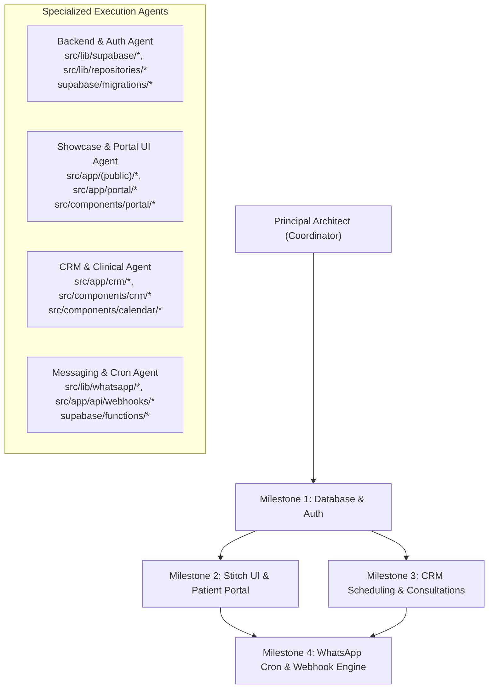

# Multi-Agent Execution Plan (`TASKS.md`): The Physio Lab

**Architecture Strategy:** Sequenced 4-Milestone Delivery with Parallelizable Subagent Tracks  
**Target Stack:** Next.js (App Router), TypeScript, Tailwind CSS, `shadcn/ui`, FullCalendar, Supabase (PostgreSQL, Auth, Private Storage, Edge Functions, `pg_cron`), Meta WhatsApp Cloud API

---

## 1. Multi-Agent Orchestration Topology

To maximize velocity while preventing merge conflicts, each milestone assigns strict directory ownership per agent track:

---

## Milestone 1: Database & Auth (`M1`)

**Objective:** Scaffold the Next.js + TypeScript + Tailwind + `shadcn/ui` workspace, deploy the PostgreSQL schema (`docs/SCHEMA.sql`) with `btree_gist` conflict prevention and RLS, build the modular TypeScript data repository layer, and implement dual authentication (CRM Role Auth + Patient WhatsApp OTP Auth).

| Task ID | Agent Role | Task Description | Key File Deliverables | Acceptance Criteria |
| :--- | :--- | :--- | :--- | :--- |
| **M1-T1** | `Scaffold & Config Agent` | Initialize Next.js App Router project with TypeScript, Tailwind CSS, `shadcn/ui` primitives, Lucide icons, and environment schema validation (`zod`). | `package.json`, `src/env.ts`, `src/components/ui/*` | `npm run build` and `tsc --noEmit` succeed with zero errors. |
| **M1-T2** | `Database Agent` | Apply `docs/SCHEMA.sql` into `supabase/migrations/0001_initial_schema.sql` and generate strict TypeScript database types + seed script for clinics, demo physios, staff, and templates. | `supabase/migrations/0001_initial_schema.sql`, `supabase/seed.sql`, `src/types/database.types.ts` | `btree_gist` exclusion constraint rejects overlapping `scheduled` appointments for the same `physio_id`; RLS policies pass role isolation tests. |
| **M1-T3** | `Data Layer Agent` | Implement modular TypeScript repository interfaces and Supabase adapters (`Clinics`, `Profiles`, `Patients`, `Appointments`, `Consultations`, `Prescriptions`, `Messages`). | `src/lib/repositories/interfaces.ts`, `src/lib/repositories/supabase/*.ts` | All UI and Server Actions consume repositories via interfaces rather than raw table queries. |
| **M1-T4** | `Auth & Middleware Agent` | Build dual authentication flow: (1) CRM login (`/crm/login`) for `admin`, `staff`, and `physio` roles; (2) Passwordless WhatsApp OTP generation & verification (`/login`) for `patient` role with rate limiting and SHA-256 OTP hashing. Configure Next.js route protection middleware. | `src/middleware.ts`, `src/app/api/auth/otp/send/route.ts`, `src/app/api/auth/otp/verify/route.ts`, `src/lib/auth/session.ts` | Unauthenticated users are redirected appropriately; `admin`/`staff`/`physio` cannot be impersonated by `patient` sessions; WhatsApp OTP links/creates the `patients` record automatically. |

**Milestone 1 Exit Gate:** Database migration applied, repository unit tests green, CRM login and Patient WhatsApp OTP verification end-to-end functional.

---

## Milestone 2: Stitch UI & Patient Portal (`M2`)

**Objective:** Build the flagship selling point of the platform—a high-converting public clinic showcase website for **The Physio Lab — Research & Rehabilitation** themed directly around the real physical clinic's architecture, extracted vector logo, and Google listing assets, seamlessly transitioning into the WhatsApp OTP-authenticated **Patient Web Interface**.

### Extracted Brand & Asset Specification (Mandatory for `M2` & `M3`)
- **Logo Assets (`public/images/clinic/`):**
  - `logo.svg` (Full horizontal lockup: 4-part teal emblem + `THE PHYSIO LAB` + `RESEARCH & REHABILITATION`) used in the public navbar, footer, CRM sidebar header, and prescription headers.
  - `logo-mark.svg` (Standalone 4-part teal heart-human emblem) used for mobile headers, favicon/app icon, and loading states.
- **Color Tokens (`src/app/globals.css` & Tailwind Theme):**
  - **Primary Brand Teal:** `#00858E` (Signage & logo emblem primary)
  - **Vibrant Aqua Accent:** `#009CA6` / `#14B8A6` (Buttons, active calendar slots, badges)
  - **Warm Architectural Stone / Linen:** `#F5F2EB` & `#E8E2D7` (Page canvas & card backgrounds matching the clinic's textured stone reception wall)
  - **Frosted Sage Glass:** `#DCE8E6` (Glassmorphic overlays & secondary panels matching the clinic's frosted glass suites and glass floor walkway)
  - **Deep Charcoal Acrylic:** `#141413` (Headings & primary typography)
- **Real Clinic Photography (`public/images/clinic/`):**
  - `clinic_photo_1.jpg` (3D exterior signage & street pillar board)
  - `clinic_photo_2.jpg` (Full 3-story architectural building facade in Barewal Awana, Ludhiana)
  - `clinic_photo_3.jpg` (Minimalist reception entrance with 3D wall logo & indoor planters)
  - `clinic_photo_4.jpg` (Rehabilitation gym floor with frosted glass therapy suites, glass floor walkway, treadmill & Desmotec eccentric training station)
- **Official Clinic Content & Pillars:**
  - **4 Core Clinical Divisions:** (1) *Research & Rehabilitation*, (2) *Physiotherapy*, (3) *Sports Injury Centre*, (4) *Lifestyle Clinic*.
  - **Contact & Social Proof:** `5.0 ★ Google Rating`, Barewal Awana, Ludhiana, Punjab, Phone: `+91 93161-96000` & `+91 98153-70607`.

| Task ID | Agent Role | Task Description | Key File Deliverables | Acceptance Criteria |
| :--- | :--- | :--- | :--- | :--- |
| **M2-T1** | `Stitch UI & Design System Agent` | Configure the custom Tailwind & CSS variable theme using the extracted palette (`#00858E` teal, `#F5F2EB` warm linen stone, `#DCE8E6` frosted sage glass, `#141413` charcoal) and integrate `logo.svg` / `logo-mark.svg` across the Public Header, Footer, Patient Portal Shell, and CRM Sidebar Shell. | `src/app/globals.css`, `src/components/brand/logo.tsx`, `src/components/layout/public-header.tsx`, `src/components/layout/portal-shell.tsx` | Brand logo, favicon, and warm-stone/teal architectural theme render consistently across mobile (`360px`) and desktop (`1920px`). |
| **M2-T2** | `Showcase UI Agent` | Build the public clinic showcase landing page (`/`): Hero section featuring `clinic_photo_3.jpg` / `clinic_photo_1.jpg` & `5.0 ★` badge, dedicated section for the **4 Core Clinical Pillars** (*Research & Rehabilitation*, *Physiotherapy*, *Sports Injury Centre*, *Lifestyle Clinic*), interactive photo tour gallery (`clinic_photo_1..4.jpg` highlighting the Desmotec rehab floor & glass suites), Barewal Awana location card with `+91 93161-96000` / `+91 98153-70607`, and sticky **"Book Appointment"** / **"Patient Portal"** CTAs. | `src/app/(public)/page.tsx`, `src/components/showcase/hero-section.tsx`, `src/components/showcase/clinical-pillars.tsx`, `src/components/showcase/facility-gallery.tsx` | All 4 real clinic photos, the SVG logo, the 4 signboard pillars, and real phone numbers are prominently showcased with 1-click transition into OTP login / self-booking. |
| **M2-T3** | `Patient Portal Agent` | Implement the WhatsApp OTP Login UI (`/login`) branded with `logo.svg`, reception backdrop (`clinic_photo_3.jpg`), 6-digit auto-advancing OTP input, countdown timer, and redirect preservation into `/portal`. | `src/app/(public)/login/page.tsx`, `src/components/portal/otp-login-form.tsx` | Patients log in with phone + 6-digit OTP and land directly on `/portal` or their intended booking step. |
| **M2-T4** | `Patient Portal Agent` | Build Patient Portal Dashboard & Self-Service Booking Wizard (`/portal`, `/portal/book`): Select Clinic (defaulting to *The Physio Lab — Barewal Awana*) -> Select Clinical Pillar / Physio (optional) -> Real-time available slot picker -> Confirm booking with instant WhatsApp confirmation trigger. | `src/app/portal/page.tsx`, `src/app/portal/book/page.tsx`, `src/components/portal/self-booking-wizard.tsx` | Real-time slot availability excludes busy ranges; booking inserts `booking_source = 'patient_portal'` and triggers confirmation. |
| **M2-T5** | `Patient Portal Agent` | Build Patient Consultation History & Prescription Vault (`/portal/history`, `/portal/prescriptions`): View past visits, clinical summaries, and inline preview/download for both **PDF** and **Image** prescriptions via signed URLs. | `src/app/portal/history/page.tsx`, `src/app/portal/prescriptions/page.tsx`, `src/components/portal/prescription-viewer.tsx` | Patients can view and download their own PDF and image prescriptions securely; cross-patient access is blocked by Storage RLS. |

**Milestone 2 Exit Gate:** Full public showcase (with real logo, 4 photos, 4 clinical pillars, and contact details) -> WhatsApp OTP login -> Patient self-booking -> Upcoming appointments -> Consultation history -> PDF/Image prescription download verified on mobile and desktop viewports.

---

## Milestone 3: CRM Scheduling & Consultations (`M3`)

**Objective:** Build the unified Web CRM for **Admin**, **Reception/Staff**, and **Physio** roles covering fast Patient Management, the Daily/Weekly Calendar + List Scheduling Engine with manual slot durations and conflict prevention, Consultation conversion, PDF/Image prescription uploads, and Admin Controls.

| Task ID | Agent Role | Task Description | Key File Deliverables | Acceptance Criteria |
| :--- | :--- | :--- | :--- | :--- |
| **M3-T1** | `CRM Patient Agent` | Build Patient Management module (`/crm/patients` & `/crm/patients/[id]`): Create/edit patient profiles, instant debounced search by name or phone (`pg_trgm`), Unified Patient History timeline (consultations, prescriptions, notes, WhatsApp logs), and **1-click quick actions** (Book Appointment, Send WhatsApp). | `src/app/crm/patients/page.tsx`, `src/app/crm/patients/[id]/page.tsx`, `src/components/crm/patients/*` | Search resolves in <150ms; Patient Detail view displays unified history and functional 1-click Book & WhatsApp modals. |
| **M3-T2** | `CRM Scheduling Agent` | Build the Multi-Clinic Scheduling Engine (`/crm/schedule`): Daily/Weekly interactive calendar (FullCalendar / TimeGrid) + Agenda List View, filters by **Clinic** and **Physio**, and Staff Booking Drawer supporting optional physio assignment and **manual slot durations** (custom minutes or start/end time). | `src/app/crm/schedule/page.tsx`, `src/components/crm/schedule/calendar-view.tsx`, `src/components/crm/schedule/booking-drawer.tsx` | Staff can book variable-duration slots; overlapping bookings for the same physio surface a clean conflict alert backed by the PostgreSQL `btree_gist` constraint. |
| **M3-T3** | `CRM Scheduling Agent` | Implement Appointment Status Transitions & Actions: Transition between `scheduled`, `completed`, `cancelled` (with reason + automatic WhatsApp trigger), and `no_show` (with automatic WhatsApp trigger). | `src/app/crm/schedule/actions.ts`, `src/components/crm/schedule/status-badge-menu.tsx` | Status updates reflect in real time on the calendar and enqueue the corresponding WhatsApp notification in `message_logs`. |
| **M3-T4** | `Clinical Workflow Agent` | Build Consultation & Prescription Module (`/crm/consultations` & `/crm/consultations/[id]`): Convert scheduled appointment to consultation, add structured/free-text clinical notes, upload **both PDF and Image** prescriptions to private Supabase Storage, and click **"Mark as Complete"**. | `src/app/crm/consultations/page.tsx`, `src/app/crm/consultations/[id]/page.tsx`, `src/components/crm/consultations/prescription-uploader.tsx` | Uploading `.pdf`, `.jpg`, `.png`, or `.webp` stores the file in `prescriptions/{patient_id}/{consultation_id}/`; marking complete updates appointment status and syncs to patient history. |
| **M3-T5** | `Admin Controls Agent` | Build Admin Control Center (`/crm/admin/*`): Manage Clinics (CRUD + operating hours), Manage Physios & Staff Users (role assignment, clinic assignment), and Configure WhatsApp Message Templates (`{{name}}`, `{{date}}`, `{{clinic}}`, `{{physio}}`). | `src/app/crm/admin/clinics/page.tsx`, `src/app/crm/admin/users/page.tsx`, `src/app/crm/admin/templates/page.tsx` | Restricted strictly to `admin` role; changes to clinics, physios, and message templates take immediate effect across scheduling and messaging. |

**Milestone 3 Exit Gate:** Staff booking flow, GIST double-booking prevention, Consultation conversion, PDF/Image upload, and Admin clinic/physio/template management verified across Admin, Staff, and Physio accounts.

---

## Milestone 4: WhatsApp Cron & Webhook Engine (`M4`)

**Objective:** Wire up the production Meta WhatsApp Cloud API dispatcher, automated 24h and 2h reminder scheduling via `pg_cron` / Edge Functions, manual CRM follow-up triggers, delivery status webhooks, exponential-backoff retry queue, and the Central Message Log dashboard.

| Task ID | Agent Role | Task Description | Key File Deliverables | Acceptance Criteria |
| :--- | :--- | :--- | :--- | :--- |
| **M4-T1** | `Messaging Agent` | Build Meta WhatsApp Cloud API service adapter with dynamic variable interpolation (`{{name}}`, `{{date}}`, `{{clinic}}`, `{{physio}}`) and fallback dry-run/sandbox logger when credentials are in local dev mode. | `src/lib/whatsapp/client.ts`, `src/lib/whatsapp/template-renderer.ts` | Supports all 6 lifecycle triggers (`booking_confirmation`, `reminder_24h`, `reminder_2h`, `appointment_cancelled`, `appointment_no_show`, `manual_followup`) + OTP dispatch. |
| **M4-T2** | `Cron & Queue Agent` | Create the Queue Dispatcher Worker (Supabase Edge Function / Next.js Cron Route + `pg_cron` schedule running every 1 minute) that claims due `queued` reminders (`24h` and `2h` prior) and retries `failed` messages where `next_retry_at <= now()` and `attempts < max_attempts`. | `supabase/functions/whatsapp-dispatcher/index.ts`, `src/app/api/cron/whatsapp-dispatch/route.ts`, `supabase/migrations/0002_pg_cron_schedule.sql` | Immediate confirmations fire on booking; 24h and 2h reminders fire on schedule; transient API errors increment `attempts` and schedule exponential backoff (`+2m`, `+10m`, `+30m`). |
| **M4-T3** | `Webhook Agent` | Implement Meta WhatsApp Cloud API Webhook endpoint (`/api/webhooks/whatsapp`) for hub challenge verification (`GET`) and asynchronous delivery/read/failure status updates (`POST` reconciling `provider_message_id` -> `delivered` / `read` / `failed`). | `src/app/api/webhooks/whatsapp/route.ts` | Verifies `X-Hub-Signature-256` HMAC signature and updates `message_logs` status timestamps accurately. |
| **M4-T4** | `CRM Messaging UI Agent` | Build the Central Message Log & Manual Follow-Up UI (`/crm/messages` + Quick Send Modal): Filterable log table showing recipient, trigger type, rendered variables, delivery status, retry count, and 1-click **"Retry Now"** or **"Send Manual Follow-Up"**. | `src/app/crm/messages/page.tsx`, `src/components/crm/messages/send-whatsapp-modal.tsx` | Staff/Admin can trigger manual follow-up templates from any patient or appointment and monitor real-time delivery/retry states in the central log. |

**Milestone 4 Exit Gate:** Full lifecycle verification—Booking Confirmation (Staff & Patient), 24h/2h scheduled reminders, Cancellation & No-Show auto-messages, Manual CRM follow-ups, Webhook receipts, and Retry Queue recovery tested end-to-end.
